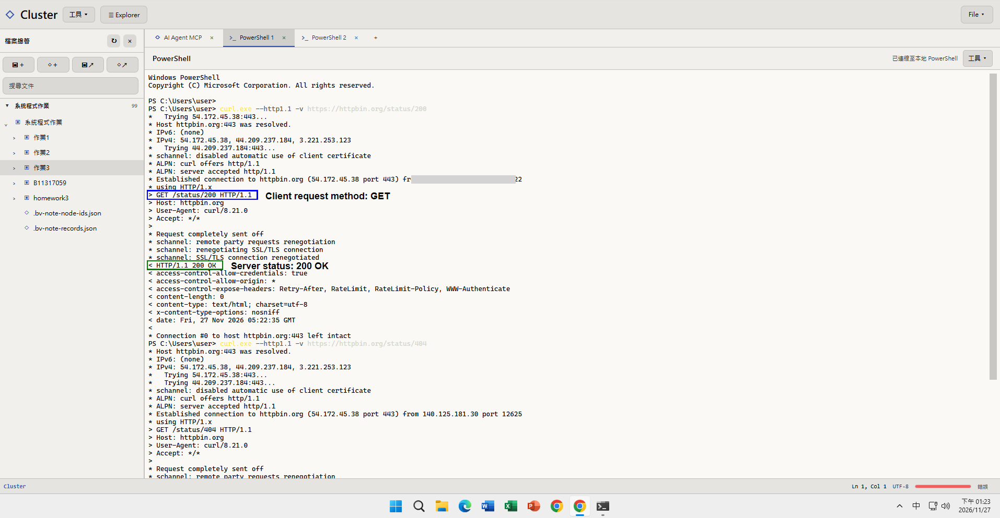
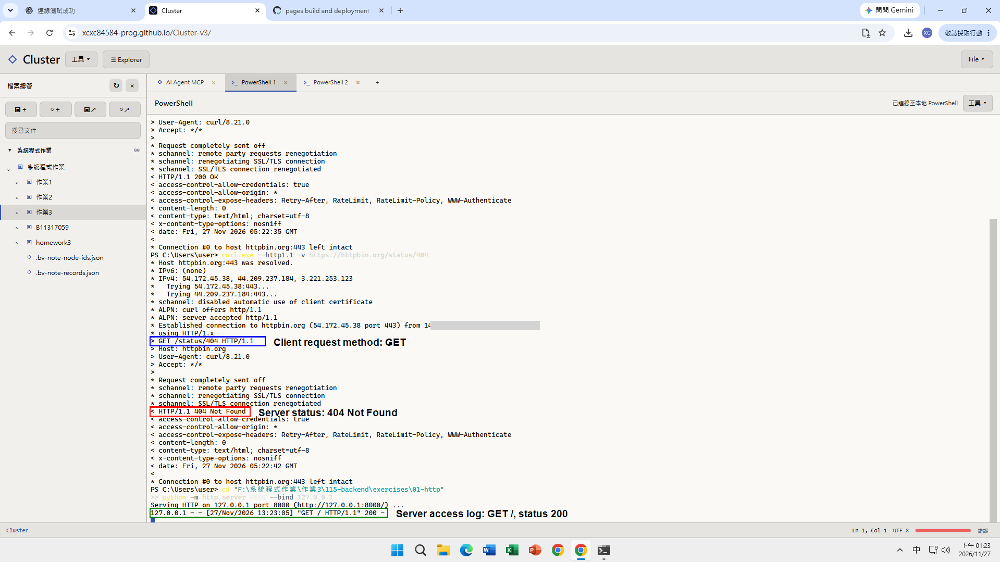
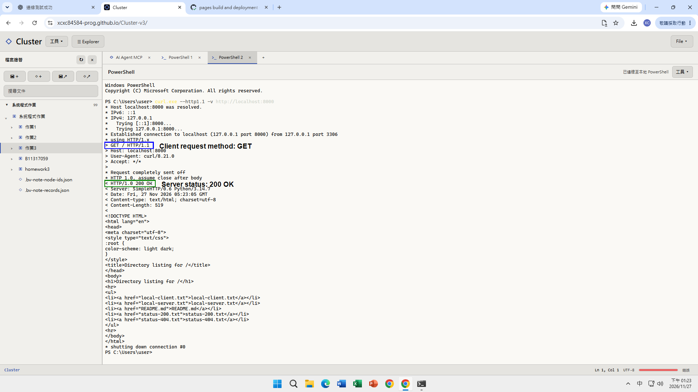

# Exercise 01 — HTTP

## HTTP status codes

Commands (Windows PowerShell):

```powershell
curl.exe --http1.1 -v https://httpbin.org/status/200
curl.exe --http1.1 -v https://httpbin.org/status/404
```

Observed request and response lines:

- `> GET /status/200 HTTP/1.1` — Client request method: GET.
- `< HTTP/1.1 200 OK` — Server status: success.
- `> GET /status/404 HTTP/1.1` — Client request method: GET.
- `< HTTP/1.1 404 Not Found` — Server status: resource not found.

## Local HTTP server

Server: `python -m http.server 8000 --bind 127.0.0.1`

Client: `curl.exe --http1.1 -v http://localhost:8000`

Observed: `> GET / HTTP/1.1` and `< HTTP/1.0 200 OK`.

Server access log: `127.0.0.1 - - [27/Nov/2026 13:20:38] "GET / HTTP/1.1" 200 -`

GET is the client-selected method; 200 is the server-selected status. The request uses HTTP/1.1 while the Python server responds with HTTP/1.0.

The screenshots below are actual terminal captures with annotations. The TXT files contain earlier independent verification output.

## Screenshots







